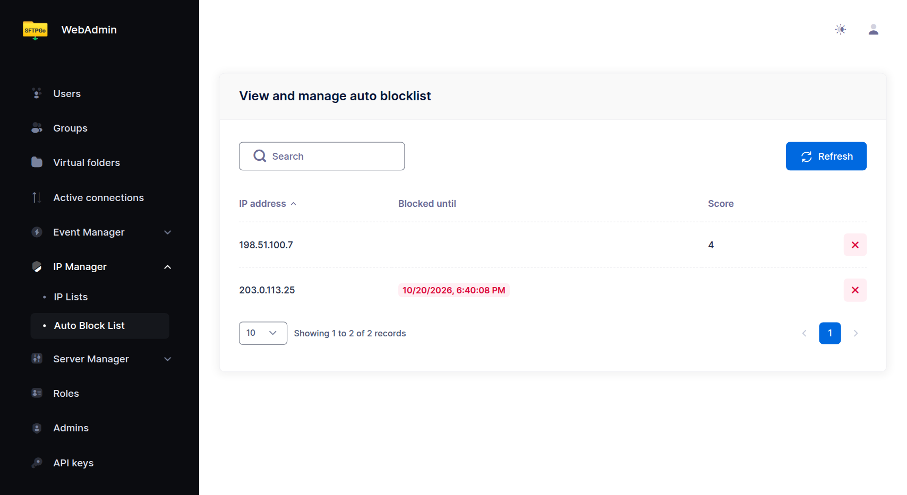

# Defender

The built-in `defender` allows you to configure an auto-blocking policy for SFTPGo and thus helps to prevent DoS (Denial of Service) and brute force password guessing.

If enabled it will protect SFTP, HTTP, FTP and WebDAV services and it will automatically block hosts (IP addresses) that continually fail to log in or attempt to connect.

You can configure a score for the following events:

- `score_valid`, defines the score for valid login attempts, eg. user accounts that exist. Default `1`.
- `score_invalid`, defines the score for invalid login attempts, eg. non-existent user accounts. Default `2`.
- `score_no_auth`, defines the score for SSH and FTP connections closed before a login attempt. Default `0`.
- `score_limit_exceeded`, defines the score for hosts that exceeded the configured rate limits or the configured max connections per host. Default `3`.

You can set the score to `0` to not penalize some events.

An SSH login refused because of the algorithms the client uses, for example a public key signature algorithm the server does not accept or the per-user `enforce_secure_algorithms` setting, adds no score: the refusal does not depend on the credential. It is logged and notified as `Algorithm negotiation failed`.

And then you can configure:

- `observation_time`, defines the time window, in minutes, for tracking client errors.
- `threshold`, defines the score at which a host is banned.
- `ban_time`, defines the time to ban a client, as minutes

:warning: All time values (`ban_time`, `observation_time`) are **integers in minutes** — fractional values such as `0.5` are not accepted. The minimum usable value is `1`. For example, to ban for one day set `ban_time=1440`.

So a host is banned, for `ban_time` minutes, when the sum of its scores during the last `observation_time` minutes reaches the defined threshold.

By defining the scores, each type of event can be weighted. For example, if `score_invalid` is 3 and `threshold` is 8, a host is banned after 3 login attempts with a non-existent user within the configured `observation_time`.

A banned IP has no score, it makes no sense to accumulate host events in memory for an already banned IP address.

Each connection from a banned host, and each request on the HTTP and WebDAV services, extends its ban by `ban_time_increment`, a percentage of `ban_time`: if `ban_time` is 30 minutes and `ban_time_increment` is 50, every new attempt adds 15 minutes. The extension is at least one minute, so a host that keeps connecting stays banned. With [`max_incomplete_connections`](#incomplete-connections) enabled, a source refused before the handshake extends its ban about once a minute instead. `ban_time_increment` accepts values from `1`; values above 100 extend the ban by more than `ban_time` at each attempt.

SFTPGo can store host scores and banned hosts in memory or within the configured data provider according to the `driver` set in the `defender` configuration section. The available drivers are `memory` and `provider`.

The `provider` driver persists scores and bans in the database, so the auto-blocklist survives restarts. Supported data providers: `SQLite`, `MySQL`, `PostgreSQL`, `CockroachDB`. Use `SQLite` for a single instance that needs persistence across restarts; use `MySQL`, `PostgreSQL`, or `CockroachDB` to share defender state across multiple SFTPGo instances.

The `provider` driver issues a database query at least every time a new client connects (to check if the IP is banned). The `memory` driver is the fastest option and is the right choice when persistence across restarts is not required.

The `provider` driver will periodically clean up expired hosts and events.

## Memory limits (`entries_soft_limit`, `entries_hard_limit`)

These two keys apply only to the `memory` driver and cap how many host scores and banned IPs SFTPGo keeps in RAM. When the number of tracked entries exceeds `entries_hard_limit`, the oldest entries are evicted until the count drops back to `entries_soft_limit`. Defaults are `100` / `150` — reasonable for most deployments. Raise them if you run a large public-facing instance that receives many distinct attacker IPs and you want longer history; lower them on memory-constrained hosts. They do not affect the security of the defender, only how much history it keeps.

The `provider` driver ignores `entries_soft_limit` (state is stored in the database); `entries_hard_limit` is used only to cap list-all API responses.

## Login delay

The defender can also impose a **login delay** — a configurable pause before reporting an authentication outcome. This slows down password-guessing bots and can mask the difference between valid and invalid usernames.

- `login_delay.password_failed` — milliseconds to wait before returning the error on a failed password/interactive login. Default `1000` (1 second). Set to `0` to disable.
- `login_delay.success` — milliseconds to wait before granting a successful login. Default `0` (disabled). Set a non-zero value to neutralize timing attacks that try to distinguish valid from invalid usernames by response time.

See the `login_delay` settings in the [configuration reference](config-file.md) for the full schema.

## Incomplete connections

With `max_incomplete_connections` at its default `0`, the defender, the rate limiters and the per-host connection limit check each HTTP and WebDAV request once its TLS handshake has completed, and on implicit FTPS the reply to a refused connection completes the handshake first. Set it above `0` to refuse banned sources before any handshake, on every protocol, and to report the sources that drop their connections before logging in.

A client can load the server by opening connections and dropping them before it tries to log in, for example by aborting TLS handshakes or SSH key exchanges. With `max_incomplete_connections` set above `0`, the defender counts these connections for each source address and protocol:

- HTTPS and WebDAV over TLS: a connection closed before its TLS handshake completes;
- SSH: a connection closed before any login attempt;
- FTP and FTPS: a connection closed without a login attempt, including one that sends `USER` and no credential.

A source that reaches `max_incomplete_connections` within a minute is reported to the defender, at most once a minute, with the `score_limit_exceeded` score, and is banned like any host whose score reaches the `threshold`. The trusted list, the defender safe list and the rate limiters safe list apply as for every other event: an address listed there is logged and never banned.

Once a source is banned, its new connections are closed as soon as they are accepted: before the TLS handshake on HTTPS, WebDAV and implicit FTPS, before the key exchange on SSH, and before the welcome message on FTP. The ban is checked again about once a minute while the source keeps connecting, so an unban from the WebAdmin applies within a minute, and each check extends the ban by `ban_time_increment`.

On HTTP and WebDAV the same setting limits each source to 1000 open connections per service, idle keep-alive connections included: further connections are closed until some of the open ones end, and the source is reported to the defender. For many browser clients behind a single address, such as a corporate NAT, raise the limit with [`SFTPGO_HOOK__DEFENDER_MAX_OPEN_CONNECTIONS_PER_HOST`](env-vars.md#defender).

In a minute in which a source has reached `max_incomplete_connections`, its further connections closed before a login attempt are logged, and notifier plugins such as the event store receive no event for them.

These checks use the client address known when the connection is accepted: on SSH and FTP every binding is covered, PROXY protocol included; on HTTP and WebDAV the bindings that accept clients directly, without `proxy_mode` set to `1`, without `client_ip_proxy_header` and on a TCP address. On the other HTTP and WebDAV bindings the defender checks each request, after the TLS handshake, on the client address read from the proxy.

The counts, the open connections and the refusals are kept in memory by each instance, also when the data provider is shared: behind a load balancer each instance counts only the connections it receives, so a source spread across several instances needs more connections before it is reported, and a restart clears the counts of that instance. With the `provider` driver the ban itself is shared, and every instance refuses the source once its own checks find the ban. Reports and refusals are logged with the `connection_admission` sender.

A source that is not attacking closes few connections before logging in, a few tens a minute at most: start with a high value such as `200` and lower it if needed.

## Managing the defender from the WebAdmin

Defender parameters (scores, threshold, `ban_time`, `observation_time`, `login_delay`, memory limits) are configured via the configuration file or environment variables. The WebAdmin is used to view and manage the IP lists under the **IP Manager** section:

- **Auto Block List** — appears once the defender is enabled. Lists dynamically banned IPs with their ban expiration. Click the **X** icon on a row to lift the ban (useful for false positives).
- **IP Lists** — always available (independent of the defender). Permanent entries you maintain by hand. The **Defender List** holds static rules for the defender: a `Deny` entry always blocks an address and an `Allow` entry always permits it, overriding a dynamic ban. When an address is covered by several entries, the most specific one (longest network prefix) wins, so a narrow allow overrides a broader deny and vice versa. See [IP Lists](ip-lists.md) for the Defender List and the other manually managed lists (Allow List, Trusted List, and Rate Limiters Safe List).

{data-gallery="defender-auto-block-list"}

The same operations are available via REST API — see `/defender/hosts` and `/ip-lists` in the [REST API reference](https://sftpgo.com/rest-api){:target="_blank"}.

## Configuration example

A reasonable starting configuration using environment variables:

```shell
SFTPGO_COMMON__DEFENDER__ENABLED=true
SFTPGO_COMMON__DEFENDER__BAN_TIME=30
SFTPGO_COMMON__DEFENDER__BAN_TIME_INCREMENT=50
SFTPGO_COMMON__DEFENDER__THRESHOLD=8
SFTPGO_COMMON__DEFENDER__OBSERVATION_TIME=15
SFTPGO_COMMON__DEFENDER__SCORE_VALID=1
SFTPGO_COMMON__DEFENDER__SCORE_INVALID=3
SFTPGO_COMMON__DEFENDER__SCORE_NO_AUTH=0
SFTPGO_COMMON__DEFENDER__SCORE_LIMIT_EXCEEDED=3
SFTPGO_COMMON__DEFENDER__MAX_INCOMPLETE_CONNECTIONS=200
```

With this configuration:

- A host is banned for **30 minutes** when its score reaches **8** within a **15-minute** window.
- Three login attempts with a non-existent user (score 3 each = 9) will trigger a ban.
- Eight login attempts with a valid username but wrong password (score 1 each = 8) will also trigger a ban.
- A source that closes 200 connections within a minute before logging in is reported with a score of 3: at the third such minute its score reaches 9 and it is banned, and from then on its connections are closed before any handshake.
- Each new attempt from the banned host extends the ban by 50% of `ban_time` (15 additional minutes); a host refused before the handshake extends it about once a minute.

To persist defender state across restarts, or to share it across all nodes in a multi-instance deployment, switch to the `provider` driver (requires a SQL-based data provider):

```shell
SFTPGO_COMMON__DEFENDER__DRIVER=provider
```
