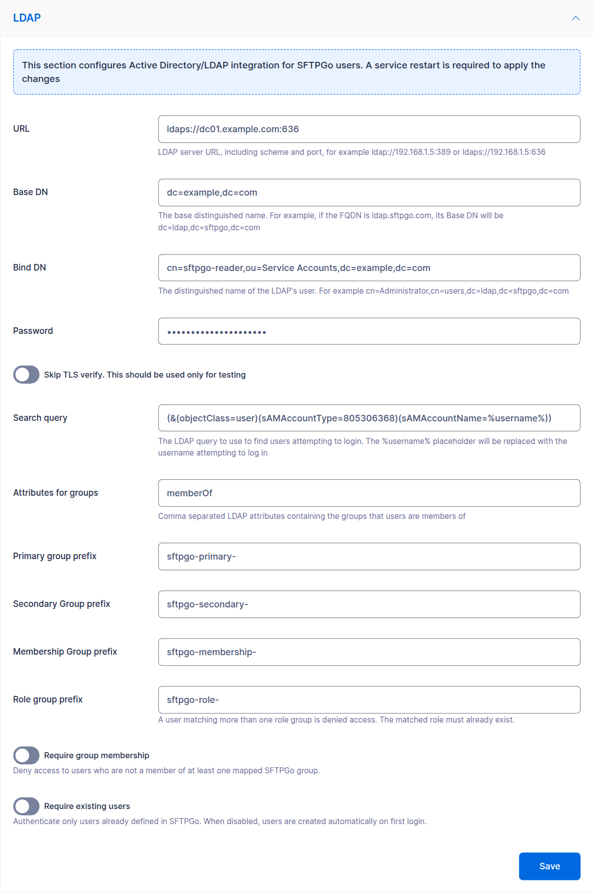

# LDAP / Active Directory Authentication

The authentication plugin enables SFTPGo to authenticate users against LDAP directories, including:

- Microsoft Active Directory
- Microsoft Entra ID (requires [Entra ID LDAP authentication](https://learn.microsoft.com/en-us/entra/architecture/auth-ldap){:target="_blank"} enabled)
- OpenLDAP and other LDAPv3-compatible directories

Users can authenticate with password or keyboard-interactive methods. After LDAP authentication, users can add SSH public keys and configure two-factor authentication through the SFTPGo WebClient.

## How it works

When a user attempts to log in:

1. The plugin searches the LDAP directory for the user.
2. It attempts to bind (authenticate) with the user's credentials.
3. If authentication succeeds, the plugin maps LDAP attributes to an SFTPGo user.
4. If the user does not exist in SFTPGo, it is created automatically (unless `--user-requirements` is set to `1`).
5. On subsequent logins, the plugin updates the SFTPGo user if LDAP attributes (email, groups, role) have changed.

Users created through LDAP have password change and password reset **disabled** in the WebClient, since password management should happen in the LDAP directory.

## Installation

Install the `sftpgo-plugins` package as described in [Audit Logs - Installation](audit-logs.md#installation). The authentication plugin binary is `sftpgo-plugin-auth`.

## Configuration

There are two alternative ways to configure LDAP. Pick **one**:

- **WebAdmin UI** — you set two environment variables to enable the LDAP section in the WebAdmin and register the plugin; every LDAP setting is then entered through the form. The configuration is persisted in the database (encrypted where appropriate) and replicated across HA nodes. The form exposes URL, Base DN, Bind DN, password, search query, group attributes, primary/secondary/membership/role group prefixes, require group membership, require existing users, and skip TLS verify.
- **Environment variables / configuration file** — every option is set through environment variables (or, for [multiple independent directories](#multiple-independent-directories), a JSON configuration file). Required when you need advanced options that the form does not expose: STARTTLS, custom CA certificates, authentication caching, base directory and storage of auto-created users, multiple independent directories.

:warning: Any configuration change requires a service restart to take effect (e.g. `systemctl restart sftpgo` on Linux, `Restart-Service sftpgo` on Windows).

### Configuration from the WebAdmin UI

To enable the LDAP section in **Server Manager > Configurations**, set these two environment variables before starting SFTPGo:

| Variable | Purpose |
| -------- | ------- |
| `SFTPGO_HOOK__ENABLE_LDAP_UI=1` | Adds the LDAP configuration accordion to the WebAdmin Configurations page |
| `SFTPGO_HOOK__AUTH_PLUGIN_PATH` | Absolute path to the `sftpgo-plugin-auth` binary that SFTPGo will register as the authentication plugin |

#### Linux

Edit `/etc/sftpgo/sftpgo.env` (create it if missing — it is the `EnvironmentFile` of the systemd unit) and add:

```shell
SFTPGO_HOOK__ENABLE_LDAP_UI=1
SFTPGO_HOOK__AUTH_PLUGIN_PATH=/usr/bin/sftpgo-plugin-auth
```

Then restart the service:

```shell
systemctl restart sftpgo
```

#### Windows

Create the file `C:\ProgramData\SFTPGo Enterprise\env.d\ldap.txt` (create the `env.d` directory if missing) with the following content:

```shell
SFTPGO_HOOK__ENABLE_LDAP_UI=1
SFTPGO_HOOK__AUTH_PLUGIN_PATH="C:\\Program Files\\SFTPGo Enterprise\\sftpgo-plugin-auth.exe"
```

Then restart the service from an elevated PowerShell:

```powershell
Restart-Service sftpgo
```

Adjust the plugin path if you installed SFTPGo Enterprise to a different directory. Backslashes inside double-quoted values must be doubled (`\\`) because the env file parser treats `\` as an escape character; alternatively, use single quotes (`'C:\Program Files\SFTPGo Enterprise\sftpgo-plugin-auth.exe'`) to disable escaping.

#### Filling in the form

After the restart, open the WebAdmin and go to **Server Manager > Configurations > LDAP**. Fill in the form and click **Save**. A service restart is required to apply the changes (the WebAdmin shows a notice).

{data-gallery="ldap-ui"}

Recommended values for **Active Directory**:

| Field | Example value |
| ----- | ------------- |
| URL | `ldaps://dc01.example.com:636` (or `ldap://dc01.example.com:389` if you also set `SFTPGO_PLUGIN_AUTH_STARTTLS=1`) |
| Base DN | `dc=example,dc=com` |
| Bind DN | `cn=sftpgo-reader,ou=Service Accounts,dc=example,dc=com` |
| Password | the bind account password |
| Search query | leave empty to use the default AD query, or set a custom one (must contain `%username%`) |
| Attributes for groups | `memberOf` |
| Primary / Secondary / Membership / Role group prefix | set as needed — see [Group mapping](#group-mapping) |

For **OpenLDAP** set the search query to `(&(objectClass=posixAccount)(uid=%username%))`.

:information_source: The form does **not** cover `STARTTLS`, custom CA certificates, the auto-created users base directory and storage, authentication caching, and multiple independent directories. If you need any of these, switch to the [environment variables approach](#configuration-via-environment-variables) — the two paths are mutually exclusive.

For Active Directory on port 389, using `ldaps://dc01.example.com:636` is the simplest way to get a secure connection without STARTTLS, keeping the UI path viable.

### Configuration via environment variables

This approach gives full control over every option and is the right choice for multiple independent directories, fully unattended setups, or whenever the form does not expose a setting you need. Do **not** combine it with `SFTPGO_HOOK__ENABLE_LDAP_UI=1`: register the plugin yourself through the `SFTPGO_PLUGINS__N__*` variables shown below.

#### Basic setup with Active Directory

This example connects SFTPGo to a single Active Directory server.

```shell
# LDAP connection
SFTPGO_PLUGIN_AUTH_LDAP_URL="ldap://dc01.example.com:389"
SFTPGO_PLUGIN_AUTH_LDAP_BASE_DN="dc=example,dc=com"
SFTPGO_PLUGIN_AUTH_LDAP_BIND_DN="cn=sftpgo-reader,ou=Service Accounts,dc=example,dc=com"
SFTPGO_PLUGIN_AUTH_LDAP_PASSWORD="your_bind_password"
SFTPGO_PLUGIN_AUTH_STARTTLS=1

# Default home directory for auto-created users
SFTPGO_PLUGIN_AUTH_USERS_BASE_DIR="/srv/sftpgo/data"

# Register the plugin with SFTPGo
SFTPGO_PLUGINS__0__TYPE=auth
SFTPGO_PLUGINS__0__AUTH_OPTIONS__SCOPE=5
SFTPGO_PLUGINS__0__CMD="/usr/bin/sftpgo-plugin-auth"
SFTPGO_PLUGINS__0__ARGS="serve"
SFTPGO_PLUGINS__0__AUTO_MTLS=1
```

:information_source: The examples above use plugin index `0`. If you have other plugins already configured (e.g., audit logs at indices `0` and `1`), adjust the index accordingly. See [Plugin indexing](../plugins.md#plugin-indexing) for details.

The `AUTH_OPTIONS__SCOPE` value determines which authentication methods use the plugin:

| Scope | Authentication methods |
| ----- | --------------------- |
| 1 | Password only |
| 4 | Keyboard-interactive only |
| 5 | Password + keyboard-interactive |

The default LDAP search query is optimized for Active Directory:

```text
(&(objectClass=user)(sAMAccountType=805306368)(sAMAccountName=%username%))
```

This searches for user accounts by their `sAMAccountName` attribute. The `%username%` placeholder is replaced with the login username.

For **OpenLDAP**, set a custom search query:

```shell
SFTPGO_PLUGIN_AUTH_LDAP_SEARCH_QUERY="(&(objectClass=posixAccount)(uid=%username%))"
```

#### Secure connections

**STARTTLS** (recommended for AD on port 389):

```shell
SFTPGO_PLUGIN_AUTH_STARTTLS=1
```

**LDAPS** (port 636):

```shell
SFTPGO_PLUGIN_AUTH_LDAP_URL="ldaps://dc01.example.com:636"
```

**Custom CA certificates** (for self-signed or internal CA):

```shell
SFTPGO_PLUGIN_AUTH_CA_CERTIFICATES="/etc/ssl/certs/internal-ca.pem"
```

Multiple certificates can be specified as a comma-separated list.

## Group mapping

The plugin can map LDAP group memberships to SFTPGo groups. This allows you to manage permissions, virtual folders, and other settings through SFTPGo groups, with membership driven by your LDAP directory.

Groups are read from the LDAP `memberOf` attribute by default. You can change this:

```shell
SFTPGO_PLUGIN_AUTH_LDAP_GROUP_ATTRIBUTES="memberOf"
```

### Mapping with prefixes

LDAP groups are mapped to SFTPGo group types based on configurable name prefixes. For each LDAP group, the plugin extracts the CN (Common Name) from the DN and checks if it starts with one of the configured prefixes.

| Prefix setting | SFTPGo group type | Description |
| -------------- | ----------------- | ----------- |
| `--primary-group-prefix` | Primary | Settings that define the user's base configuration. A user has one primary group: membership in more than one matching group fails the login. |
| `--secondary-group-prefix` | Secondary | Additional settings merged on top of the primary group. |
| `--membership-group-prefix` | Membership | Lightweight group associations (e.g., for share governance). |

**Example:** Your AD has these groups:

- `CN=sftpgo-primary-sales,OU=Groups,DC=example,DC=com`
- `CN=sftpgo-secondary-readonly,OU=Groups,DC=example,DC=com`
- `CN=sftpgo-membership-projectx,OU=Groups,DC=example,DC=com`

Configure the prefixes:

```shell
SFTPGO_PLUGIN_AUTH_PRIMARY_GROUP_PREFIX="sftpgo-primary-"
SFTPGO_PLUGIN_AUTH_SECONDARY_GROUP_PREFIX="sftpgo-secondary-"
SFTPGO_PLUGIN_AUTH_MEMBERSHIP_GROUP_PREFIX="sftpgo-membership-"
```

A user who is a member of all three AD groups will be assigned to SFTPGo groups `sftpgo-primary-sales` (primary), `sftpgo-secondary-readonly` (secondary), and `sftpgo-membership-projectx` (membership).

:information_source: Prefix matching is case-insensitive and the SFTPGo group name is the CN in lower case. The corresponding SFTPGo groups must already exist; the plugin maps users to groups but does not create the groups. No configured prefix (primary, secondary, membership, role) can be the beginning of another one, for example `sftpgo_` and `sftpgo_admin_`: groups are matched in a fixed order, so the shorter prefix would also take the groups meant for the longer one. Such a configuration is rejected.

### Mapping a role

The plugin can also assign an SFTPGo [role](../roles.md) from LDAP group membership, which is useful for delegated, multi-tenant administration. It reads the same group attribute used for group mapping and matches a dedicated prefix:

```shell
SFTPGO_PLUGIN_AUTH_ROLE_GROUP_PREFIX="sftpgo-role-"
```

A user who is a member of `CN=sftpgo-role-bank,OU=Groups,DC=example,DC=com` is assigned the SFTPGo role `sftpgo-role-bank`.

An SFTPGo user can have only one role. Since the role drives tenant isolation, the plugin assigns it only when the membership is unambiguous:

- Exactly one matching role group: the role is assigned.
- No matching role group: the role is left empty (the user is managed by the super administrator).
- More than one matching role group: the login is refused, to avoid an ambiguous cross-tenant assignment.

:information_source: Prefix matching is case-insensitive and the role name is matched in lower case. The role must already exist in SFTPGo; the plugin assigns the role but does not create it. If the matched role does not exist, the user update fails and the login is rejected even when the credentials are valid. The role prefix must not overlap the group prefixes (no prefix can be a prefix of another), otherwise the configuration is rejected. When this setting is empty the user's role is left untouched.

### Requiring group membership

To deny access to users who are not members of any mapped group:

```shell
SFTPGO_PLUGIN_AUTH_REQUIRE_GROUPS=true
```

## User requirements

By default (`--user-requirements=0`), the plugin auto-creates SFTPGo users on first LDAP login. Auto-created users get:

- Storage on the local disk, with the home directory under `--users-base-dir` (e.g., `/srv/sftpgo/data/username`)
- Full permissions on `/`
- Email address from the LDAP `mail` attribute
- Password change and reset disabled in WebClient

### Storage from the primary group

Auto-created users are members of their primary group like any other user, so the group storage applies to them: a cloud or remote backend set on the group, such as an S3 bucket or an Azure container, replaces the local disk, and a home directory set on the group replaces the one under `--users-base-dir`. See [Storage](../groups.md#storage). A user with no primary group, or whose group sets neither, keeps the local disk under `--users-base-dir`.

To require the storage to come from the primary group, set:

```shell
SFTPGO_PLUGIN_AUTH_FS_PROVIDER=-1
```

The plugin then creates users with the storage set to ["None"](../groups.md#users-with-storage-none): the login works only when the primary group provides a storage, and is refused otherwise. A user matching no primary group cannot be saved and its login is refused too, so this setting requires a primary group prefix. Under a role with [resource isolation](../roles.md#storage-allowlist), the storage allowlist must include the backend of their group, while a local disk entry is not needed.

The setting applies when the plugin creates a user: users already stored in SFTPGo keep their storage.

### Pre-created users

To require that users already exist in SFTPGo before they can authenticate via LDAP:

```shell
SFTPGO_PLUGIN_AUTH_USER_REQUIREMENTS=1
```

In this mode the plugin checks the LDAP credentials and, when configured, the group and role requirements, but does not change the SFTPGo user. The SFTPGo user must be pre-created (manually or via API), allowing full control over permissions, virtual folders, and quotas.

## Caching

To reduce LDAP queries, you can cache successful authentications:

```shell
SFTPGO_PLUGIN_AUTH_CACHE_TIME=300
```

This caches credentials for 300 seconds (5 minutes). During this period, the user can log in without contacting the LDAP server.

:warning: Caching is automatically disabled when group or role mapping is configured. This ensures that group membership and role changes in LDAP are always reflected immediately. With [multiple independent directories](#multiple-independent-directories), `cache_time` applies to the directory where it is set.

## High availability with multiple LDAP servers

### Multiple URLs (load balancing)

For a single LDAP configuration with multiple servers, provide multiple URLs:

```shell
SFTPGO_PLUGIN_AUTH_LDAP_URL="ldap://dc01.example.com:389,ldap://dc02.example.com:389"
```

The plugin randomly selects from the available servers and automatically removes unresponsive ones. A background health check restores servers when they become available again.

## Multiple independent directories

A JSON configuration file defines several independent LDAP directories, each with its own URLs, base DN, credentials, search query and group mapping, for example employees in Active Directory and partners in a separate directory:

```shell
SFTPGO_PLUGIN_AUTH_CONFIG_FILE="/etc/sftpgo/ldap-config.json"
```

When the configuration file is set, every option comes from the file and the other LDAP environment variables and flags are ignored.

Example configuration:

```json
{
  "cache_size": 100,
  "configs": [
    {
      "dial_urls": ["ldap://dc01.example.com:389", "ldap://dc02.example.com:389"],
      "base_dn": "dc=example,dc=com",
      "bind_dn": "cn=sftpgo-reader,ou=Service Accounts,dc=example,dc=com",
      "password": "password1",
      "start_tls": 1,
      "search_query": "(&(objectClass=user)(sAMAccountType=805306368)(sAMAccountName=%username%))",
      "group_attributes": ["memberOf"],
      "primary_group_prefix": "sftpgo-primary-",
      "secondary_group_prefix": "sftpgo-secondary-",
      "require_groups": true,
      "base_dir": "/srv/sftpgo/data"
    },
    {
      "dial_urls": ["ldap://ldap.partner.com:636"],
      "base_dn": "dc=partner,dc=com",
      "bind_dn": "cn=reader,dc=partner,dc=com",
      "password": "password2",
      "search_query": "(&(objectClass=posixAccount)(uid=%username%))",
      "base_dir": "/srv/sftpgo/partners"
    }
  ]
}
```

Each entry of `configs` is a complete configuration, with the keys listed in the [configuration reference](#configuration-reference).

At login the plugin tries the directories in order, and the first one that authenticates the user decides the outcome:

- That directory verifies the password and provides the user's email, groups and role. The other directories are not consulted.
- A refusal moves on to the next directory, whatever its cause: unknown user, wrong password, missing required group, more than one role group, directory unreachable. A user present in several directories therefore logs in with the password of any of them.

`cache_size` sets how many usernames the plugin remembers together with the directory that last authenticated them (default `100`). That directory is tried first at the next login.

:information_source: Credentials, groups and role of a user come from the same directory. If group membership is kept in a different directory from the credentials, there are two options. You can set `sftpgo_user_requirements` to `1`, so that the plugin only checks the credentials and does not change the SFTPGo user, and assign the groups to the SFTPGo users through the REST API. Or you can expose both directories as a single view through an LDAP proxy.

## Configuration reference

| Environment variable | Flag | Configuration file key | Description |
| -------------------- | ---- | ---------------------- | ----------- |
| `SFTPGO_PLUGIN_AUTH_LDAP_URL` | `--ldap-url` | `dial_urls` (list) | LDAP server URL(s), comma-separated. Supports `ldap://` and `ldaps://` |
| `SFTPGO_PLUGIN_AUTH_LDAP_BASE_DN` | `--ldap-base-dn` | `base_dn` | Base DN for searches (e.g., `dc=example,dc=com`) |
| `SFTPGO_PLUGIN_AUTH_LDAP_BIND_DN` | `--ldap-bind-dn` | `bind_dn` | DN of the account used for LDAP searches |
| `SFTPGO_PLUGIN_AUTH_LDAP_PASSWORD` | `--ldap-password` | `password` | Password for the bind DN |
| `SFTPGO_PLUGIN_AUTH_LDAP_SEARCH_QUERY` | `--ldap-search-query` | `search_query` | LDAP search filter. Use `%username%` as placeholder |
| `SFTPGO_PLUGIN_AUTH_LDAP_GROUP_ATTRIBUTES` | `--ldap-group-attributes` | `group_attributes` (list) | LDAP attributes for group membership (default: `memberOf`) |
| `SFTPGO_PLUGIN_AUTH_PRIMARY_GROUP_PREFIX` | `--primary-group-prefix` | `primary_group_prefix` | Prefix for primary group mapping |
| `SFTPGO_PLUGIN_AUTH_SECONDARY_GROUP_PREFIX` | `--secondary-group-prefix` | `secondary_group_prefix` | Prefix for secondary group mapping |
| `SFTPGO_PLUGIN_AUTH_MEMBERSHIP_GROUP_PREFIX` | `--membership-group-prefix` | `membership_group_prefix` | Prefix for membership group mapping |
| `SFTPGO_PLUGIN_AUTH_ROLE_GROUP_PREFIX` | `--role-group-prefix` | `role_group_prefix` | Prefix for role mapping. A user matching more than one role group is refused |
| `SFTPGO_PLUGIN_AUTH_REQUIRE_GROUPS` | `--require-groups` | `require_groups` (boolean) | Deny access if no groups match (default: `false`) |
| `SFTPGO_PLUGIN_AUTH_USER_REQUIREMENTS` | `--user-requirements` | `sftpgo_user_requirements` | `0` = auto-create users, `1` = users must pre-exist |
| `SFTPGO_PLUGIN_AUTH_STARTTLS` | `--starttls` | `start_tls` | Use STARTTLS (`1` = enabled) |
| `SFTPGO_PLUGIN_AUTH_USERS_BASE_DIR` | `--users-base-dir` | `base_dir` | Base directory for auto-created user home directories |
| `SFTPGO_PLUGIN_AUTH_FS_PROVIDER` | `--fs-provider` | `fs_provider` | Storage of auto-created users: `0` = local disk (default), `-1` = ["None"](#storage-from-the-primary-group), the primary group must provide it |
| `SFTPGO_PLUGIN_AUTH_CACHE_TIME` | `--cache-time` | `cache_time` | Cache authentication results for N seconds (`0` = disabled) |
| `SFTPGO_PLUGIN_AUTH_SKIP_TLS_VERIFY` | `--skip-tls-verify` | `skip_tls_verify` (boolean) | Skip TLS certificate verification (`1` = skip). For testing only |
| `SFTPGO_PLUGIN_AUTH_CA_CERTIFICATES` | `--ca-certificates` | `ca_certificates` (list) | Additional CA certificate file paths, comma-separated |
| `SFTPGO_PLUGIN_AUTH_CONFIG_FILE` | `--config-file` | | Path to the JSON configuration file for [multiple independent directories](#multiple-independent-directories) |
