# Public Shares

Public shares allow users to share files directly from the WebClient UI with external contacts, without creating user accounts for them.

Each public share generates a unique, web-accessible URL, and users can configure access controls such as:

- Read-only or upload permissions
- Optional password protection
- Expiration date
- Download/upload limits
- Email-based access for extra security

Public shares are managed by the users themselves, not by administrators. Users with access to the files can therefore share them with clients, partners or other external recipients without administrator intervention.

:information_source: A symbolic link beneath the shared path is dereferenced when its path is requested directly: its target is served through the share. See [Symbolic links and permissions](../config-file.md#symbolic-links-and-permissions).

## Preliminary Note

To enable email-based access to public shares and email notifications, you need to configure an SMTP server.

To configure and test your SMTP settings, open the WebAdmin UI, then go to the "Configurations" page under the "Server Manager" section. There, you can enter the required SMTP configuration parameters.

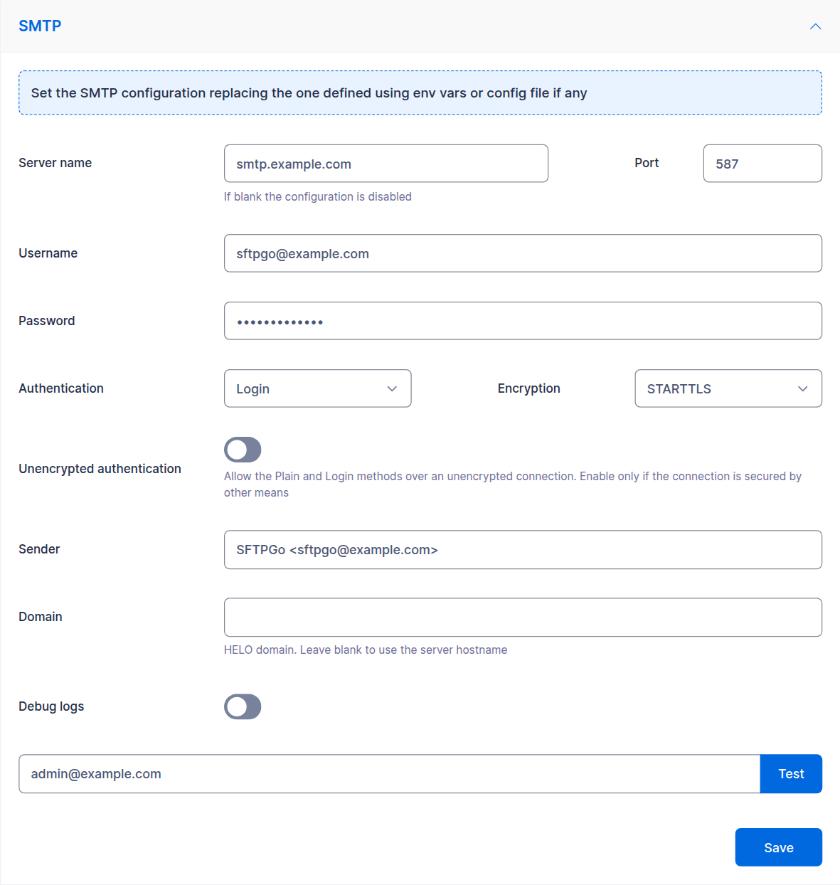{data-gallery="smtp"}

## Create a Share with Email Authentication

To share a file or folder, open the WebClient, click the three-dot menu next to the item, and select "Share".

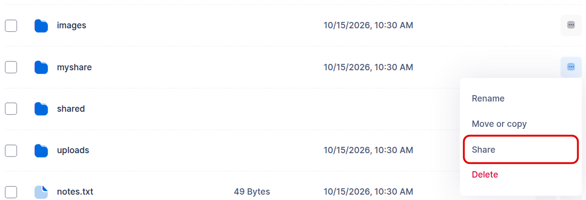{data-gallery="webclient-share"}

Next, configure the sharing options. You can define the access level—read, write, or read/write—to control what actions recipients are allowed to perform.

To enable email-based authentication, enter one or more email addresses and check the "Email authentication" option.

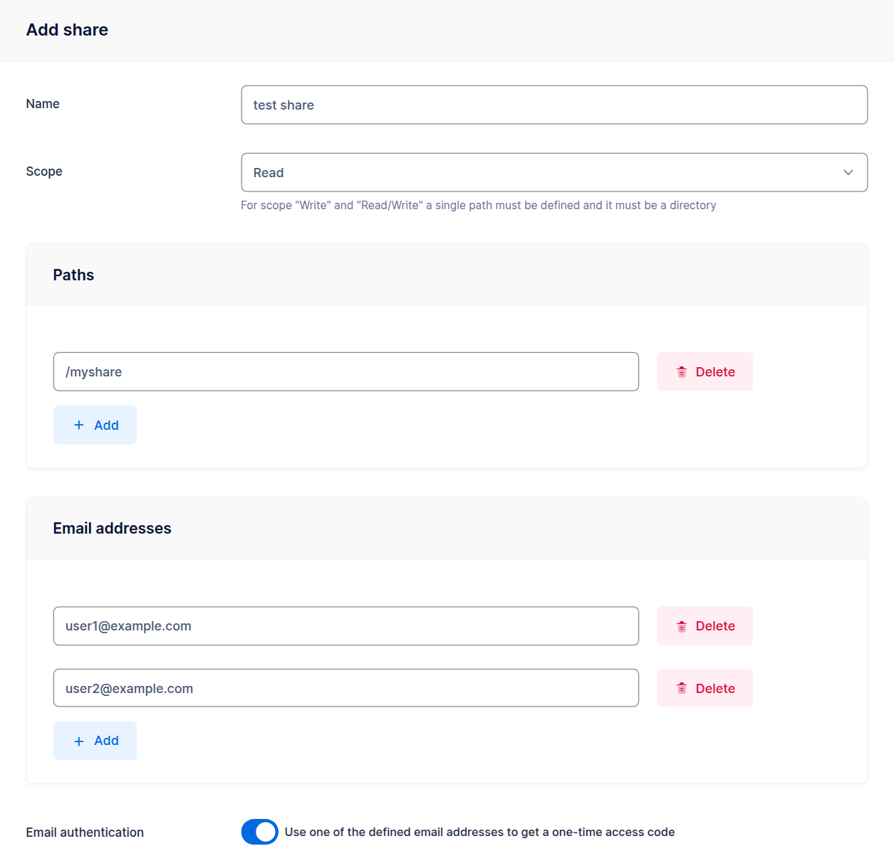{data-gallery="webclient-config-share"}

You can also require recipients to accept a (customizable) legal agreement before accessing the share, an option available when `SFTPGO_HOOK__HAS_SHARE_LEGAL_AGREEMENT` is set to `1` (see [environment variables](../env-vars.md)). Additionally, you can set an expiration date, limit the maximum number of accesses, and restrict access to specific IP addresses or networks.

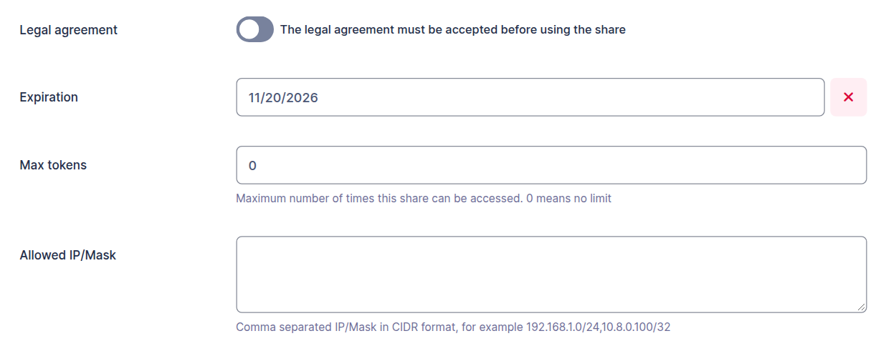{data-gallery="webclient-config-share"}

To share content with external users, go to the "Shares" page, click the "Link" icon next to the desired share, and copy the access URL. In most cases, a single directory will be shared.

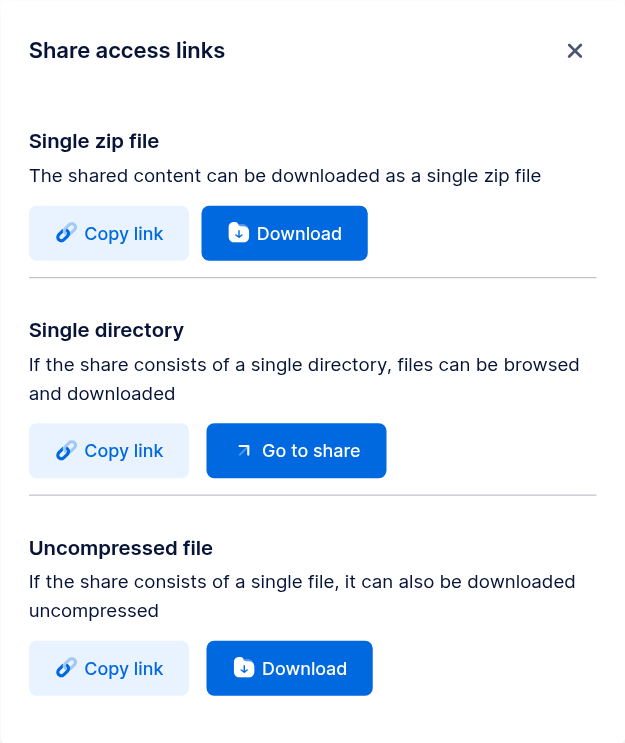{data-gallery="webclient-share-link"}

## How External Users Access the Share

External users can access the share link by entering their email address, after which they receive a one-time login code via email, valid for 10 minutes.

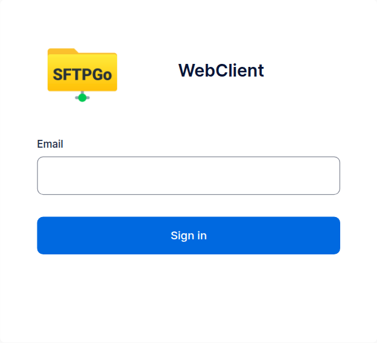{data-gallery="webclient-share-login"}

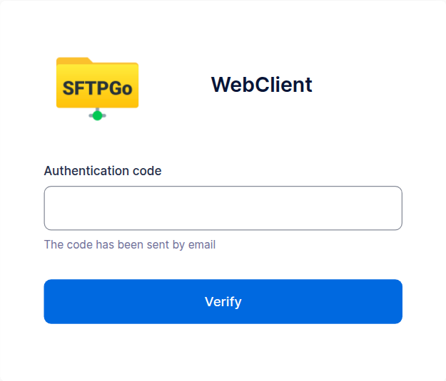{data-gallery="webclient-share-login"}

The content visible to the user depends on the type of share they’ve been granted access to.

### Read-Only Shares

Read-only shares allow external users to browse the shared directories and files. Users can view file names, structure, and metadata (such as file size and modification date), but cannot upload, modify, or delete any content.

Users can:

- Download individual files directly.
- Download all shared files and folders as a single compressed .zip archive for convenience.

This share type is suited to distributing documents, reports or other files when write access is not required.

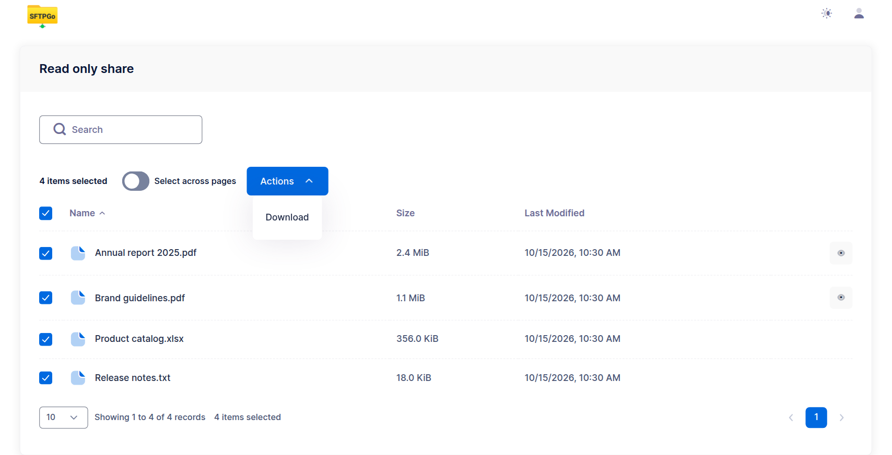{data-gallery="webclient-ro-share"}

### Write-Only shares

Write-only shares allow external users to upload files to a shared location, but they cannot view, browse, or download any existing content.

Upon accessing the share, users see a simple upload interface that displays:

- The name of the share, to provide context.
- Options to select files or a whole folder, or to drop them onto the page. A folder is uploaded with its directory structure.

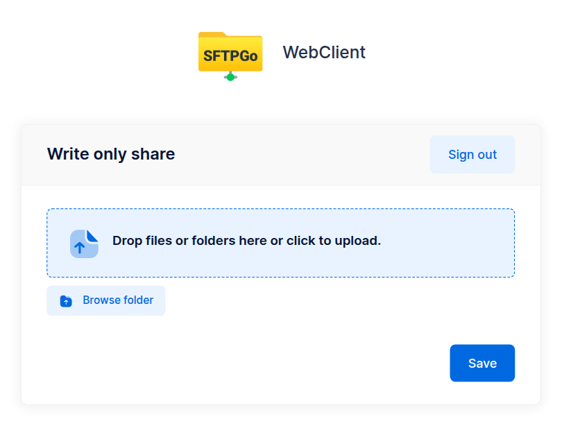{data-gallery="webclient-w-share"}

### Read/write Shares

Read/write shares provide external users with full access to the shared content, allowing them to:

- Browse files and folders within the share.
- Download individual files or the entire shared content as a .zip archive.
- Upload new files via manual selection or drag and drop.
- Create new folders within the shared structure.

This type of share combines the capabilities of both read-only and write-only shares, making it suited to scenarios where external users need to both access and contribute files to a shared workspace.

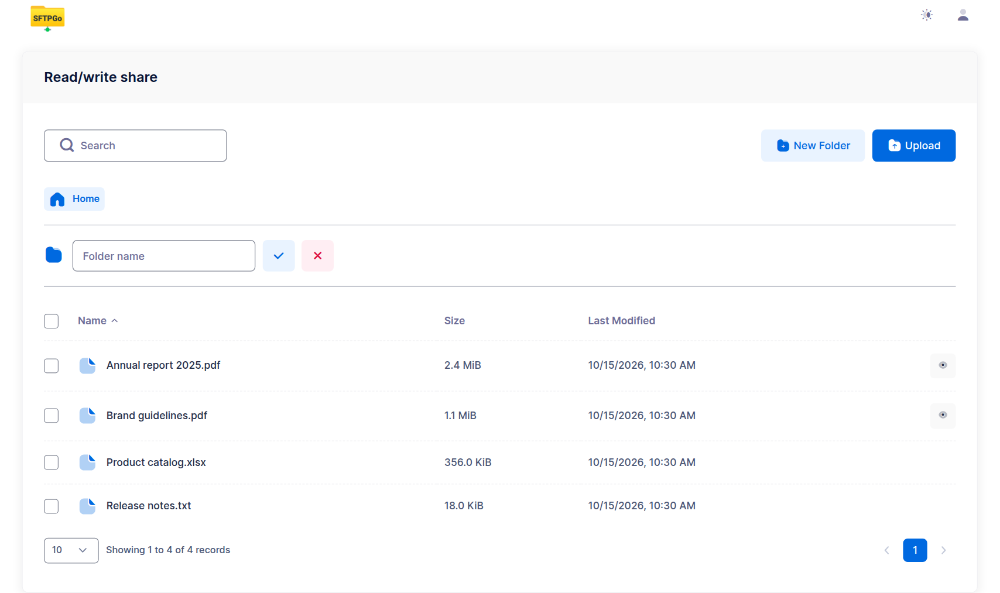{data-gallery="webclient-rw-share"}

## Restricting Shareable Paths

Administrators can restrict which virtual paths users are allowed to share by combining two filters: **Allowed share paths** (a positive list — when set, shares are accepted only within those subtrees) and **Denied share paths** (a negative list — paths that cannot be shared). Both can be set directly on a user or inherited from a group.

### Denied share paths

When a path is denied, the user cannot create shares for that exact path or any sub-path. For example:

- Denying `/` blocks sharing the root directory, but sub-directories like `/docs` or `/projects` can still be shared.
- Denying `/backup` blocks sharing `/backup`, `/backup/daily`, `/backup/daily/file.txt`, and any other path under `/backup`.
- Denying `/vfolder` blocks sharing a specific virtual folder and its contents.

### Allowed share paths

When the **Allowed share paths** list is non-empty, only paths at or below one of its entries can be shared. Useful when users have a broad home directory and you want to scope their sharing to specific subtrees:

```
/projects/team-shares
/partners/external-shares
```

With this setting, a user can share `/projects/team-shares/report.pdf` or `/partners/external-shares/q4` but not `/`, `/projects/private`, or any sibling folder.

The string `/` in the allowed list acts as a wildcard (matches any path). In the denied list, `/` matches the root only — preserving the behavior described above.

### Combining the two lists

When both lists are set, SFTPGo evaluates the share path with longest-prefix-match: the more specific entry wins. If the same path appears in both lists, the denied entry takes precedence. This lets you express common patterns:

**Allowed subtree with a carve-out**

```
allowed: /projects
denied:  /projects/confidential
```

`/projects` and most descendants are shareable; `/projects/confidential` and its descendants are not.

**Default-allow with explicit blocks**

```
allowed: /
denied:  /sensitive
```

Everything is shareable except `/sensitive` and its descendants.

**Nested override**

```
allowed: /projects, /projects/confidential/public
denied:  /projects/confidential
```

`/projects/confidential/public` is shareable (the more specific allow entry wins); other paths under `/projects/confidential` remain blocked.

### Configuration and inheritance

Both fields are textareas in the user or group settings, in the "Sharing" card of the "ACLs" section of the WebAdmin UI. Enter one or more virtual paths separated by commas.

When configured at the group level, both lists are inherited additively by group members and deduplicated with any user-level entries.

:information_source: A group-level **Denied share paths** entry holds against a user-level **Allowed share paths** entry for the same path: on a tie the denied entry wins. A user-level allowed entry deeper than the denied path wins instead, as in the nested override example above, so a hard restriction must be reviewed against the allowed entries of the members.

:information_source: Both lists are checked against the path being shared, not against its content. With `/sensitive` denied, the user can still share `/`, and that share serves `/sensitive` too. To keep a subtree out of every share, use **Allowed share paths** to limit sharing to directories that do not contain it, or deny its parent directories as well.

:information_source: Both filters match the virtual path of the share. A symbolic link placed beneath a shareable path is dereferenced, as on every other protocol, so its target is served through the share. Where these filters must hold, keep symbolic-link creation disabled — its default [`symlink_mode`](../config-file.md#symbolic-links-and-permissions) — and provision the shareable subtrees accordingly.

:warning: Tightening either filter takes effect immediately, including for shares that already exist: if a previously-shared path is no longer allowed (or is now denied), the share reads as missing until the filter is relaxed or the share is removed.

## Restricting Share Scopes

Administrators can also restrict which share scopes (read, write, read/write) users are allowed to use by configuring the **Denied share scopes** filter.

For example, denying the "read/write" scope forces users to create either read-only or write-only shares, but not combined read/write shares. This is useful when you want to enforce a clear separation between upload-only and download-only shares.

If all three scopes are denied, sharing is completely disabled for the user — equivalent to setting the "shares-disabled" web client option.

## Restricting Recipient Email Domains

The **Allowed share email domains** filter limits share recipients to the listed email domains. When the list is set:

- Every share uses [email authentication](#create-a-share-with-email-authentication), and the share form selects it by default.
- Every recipient address belongs to one of the listed domains. Domains match exactly, regardless of case: to accept addresses of both `example.com` and `sub.example.com`, list both.

The field is a textarea in the user or group settings, in the "Sharing" card of the "ACLs" section of the WebAdmin UI. Enter one or more domains separated by commas, for example `example.com, example.net`.

The lists of the user, of its primary group and of its secondary groups are combined: an address is accepted when its domain appears in any of them.

:warning: The list applies to existing shares as well, from the moment it is set: a share is served while it uses email authentication and every recipient belongs to one of the listed domains, and any other share reads as missing until it is updated or the list allows it.

:information_source: The filter decides who can open the share link. A recipient can pass the downloaded files on, and the share owner can download the same files through the other protocols enabled for the account. Combine the filter with the protocols and permissions granted to the user.

## Delegating Share Management

By default, a public share is managed only by the user who created it. To let colleagues manage it, for example to extend an expiration date or revoke access while the owner is away, the owner associates the share with one or more groups. The other members of each group see the share in their list and act on it according to the permissions granted to that group:

- **Read**: view its details, such as the link.
- **Edit**: modify its settings, such as the expiration date.
- **Delete**: revoke the share.

Only the owner can modify shared paths (files and folders), access scope (read/write), and group associations. File paths are tied to the specific context of the user who created the share (e.g., a virtual path like `/docs` may map to different storage backends, or to different locations within the same backend, depending on the user).

The owner can associate a share with any of the groups they belong to. The association is set from the WebClient, as described below, or through the REST API.

When the group exists only to delegate share management, the way the users are added to it decides how their shares get associated:

- as a [membership group](../groups.md): the group applies no settings, and the owners select it on each share themselves;
- as a secondary group: a [share policy](#group-share-policy-webadmin) on the group can also associate their shares automatically.

### Group Share Policy (WebAdmin)

A share policy on a group associates the shares created by its members with that group automatically. The policy is optional: without it, owners choose the groups themselves. It is defined within the "ACLs" section of a group's configuration.

:warning: The policy is a group setting, and a membership group applies no settings: the policy reaches only the users who belong to the group as **primary** or **secondary** group. The type is not a property of the group but is chosen for each user, in the user's page, so the same group can be secondary for one user and membership for another. For the users who have the group under **Membership groups** the policy does nothing: their shares are associated with the group only when they select it in the Group Access section. To associate their shares automatically, move the group to their **Secondary groups**: a group that defines only the share policy adds nothing else to them.

The policy consists of the Permissions granted to other group members (Read, Edit, Delete) and the Mode:

- **Mandatory (Enforced)**: The share policy is mandatory. Every share created by a user in this group is automatically associated with the group using the defined permissions. The user cannot remove this association.
- **Suggested (Removable)**: The share policy is pre-selected by default when creating a share, but the user is free to modify the permissions or remove the group association entirely.

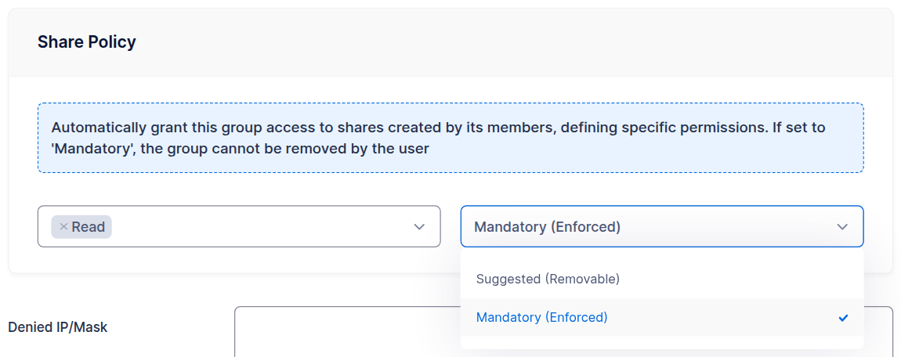{data-gallery="webadmin-share-policy"}

The `shares-policy-change-disabled` WebClient option, set on a user or inherited from a group, hides the group access settings from the user: their shares are associated only with the groups whose policy is mandatory.

### User Experience (WebClient)

When the owner belongs to at least one group, the share page of the WebClient shows a **Group Access** section, which lists the groups the owner belongs to. Groups with a mandatory policy are added automatically, groups with a suggested policy are pre-selected.

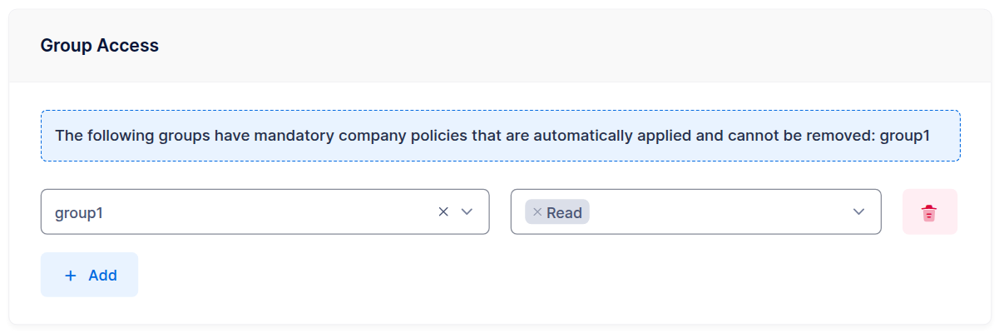{data-gallery="webclient-group-access"}

In the example above, the "Read" permission was granted for "group1": all members of "group1" see this share in their list, in addition to the shares they created themselves, and can view its details, such as the link, but cannot modify its settings or delete it.

## Automatically Send Share Links

Administrators can configure an Event Manager rule and corresponding action from the WebAdmin UI to automatically send an email notification to all email addresses associated with a share whenever a new share is created.
The email includes the access link, ensuring that recipients are promptly notified without requiring any manual steps.

From the WebAdmin UI, create an email action similar to the example below.

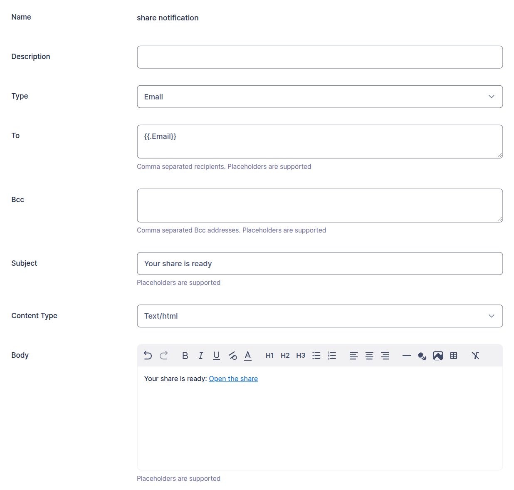{data-gallery="webadmin-add-share-notify"}

Use the `{{.Email}}` placeholder to automatically insert the email addresses associated with the share—these are the recipients who can authenticate to access it.

In the body, select the text of the link, click **Insert Link** in the menu that appears over the selection, or in the editor toolbar, and enter the share access URL, which follows this format:

```shell
https://sftp.example.com/web/client/pubshares/{{.ObjectName | urlPathEscape }}/browse
```

Where:

- `https://sftp.example.com` is the externally accessible base URL of your SFTPGo installation.
- `{{.ObjectName}}` expands to the ID of the share.
- The `urlPathEscape` helper function ensures the share ID is properly URL-encoded.

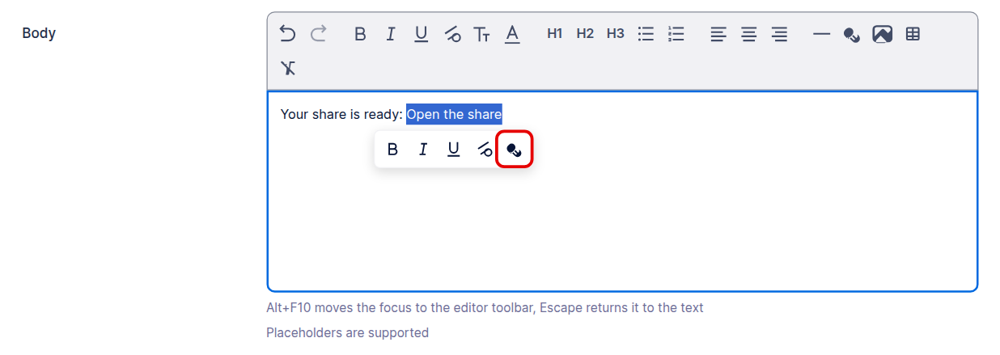{data-gallery="webadmin-email-editor"}

Finally, create an Event Manager rule that triggers this action whenever a new share is created.

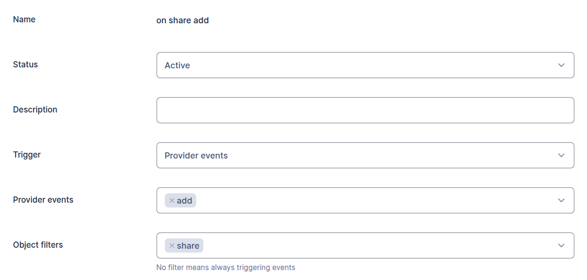{data-gallery="webadmin-add-share-notify"}
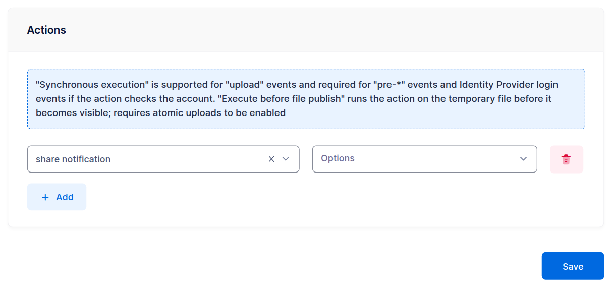{data-gallery="webadmin-add-share-notify"}

## Enable Upload/Download Notifications

SFTPGo allows administrators to configure notifications when an external user uploads or downloads a file through a share.

For example, you can set up an Event Manager rule and action to automatically send an email notification to the SFTPGo user who created the share.
The notification can include:

- The name and details of the file uploaded or downloaded.
- The email address of the external user who accessed the share and performed the action.

Here is an example action.

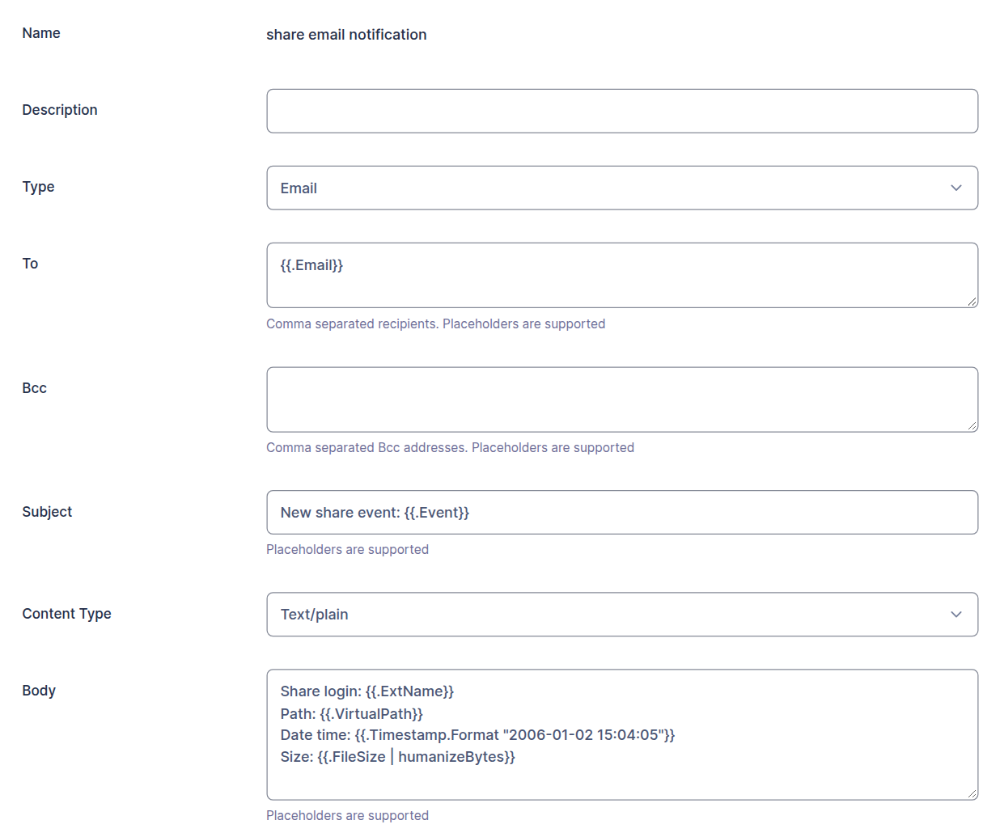{data-gallery="webadmin-share-event-notify"}

In this case, the action is triggered by a file system event (such as an upload or download), so:

- The `{{.Email}}` placeholder expands to the email address of the SFTPGo user who created the share.
- The `{{.ExtName}}` placeholder expands to the email address used by the external user to access the share.

Here is an example rule to execute the above action.

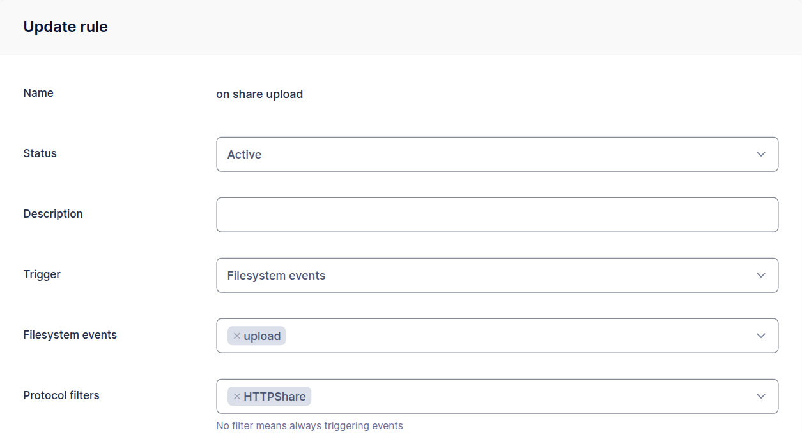{data-gallery="webadmin-share-event-notify"}

Naturally, all operations performed on shares, including uploads and downloads, are also recorded in the audit logs.

## Owner Account State

A public share is served on behalf of the account that created it, and follows the state of that account.

- Disabling the owner account, or reaching its expiration date, makes its shares unavailable. The shares are not modified, so re-enabling the account, or extending its expiration date, makes them available again.
- Deleting the owner account deletes its shares.
- The restrictions that govern when the account holder can log in, such as the [time-based access](../access-control.md#time-based-access) windows, apply to the account holder, not to the recipient of a share.
- Sessions already established follow the general rule described in [When account changes take effect](../access-control.md#when-account-changes-take-effect); closing them covers the connections serving the shares as well.

## Automating Share Lifecycle Management

SFTPGo can automatically manage the lifecycle of public shares to ensure security and compliance. By using the Event Manager, administrators can configure rules to detect shares that are inactive, about to expire, or have exhausted their allowed tokens, and take appropriate actions (such as sending a notification or deleting the share).

### Step 1: Create the Expiration Check Action

First, you need to define the criteria for what constitutes an "expired" or "inactive" share.

1. Go to **EventManager** -> **Actions** and click **Add**.
2. Select **Share expiration check** as the action type.
3. Configure the following parameters:
   - **Inactivity threshold**: Defines the validity period (in days) for shares **without an explicit expiration date**. The expiration is calculated based on the last usage time (or the creation time if the share has never been used). If set to 0, automatic expiration based on inactivity is disabled.
   - **Advance notice**: How many days before the actual expiration (or the calculated inactivity expiration) to trigger a "notification" event.
   - **Grace period**: How many days to keep an expired share in the database before permanently deleting it (Soft Delete).
   - **Split events**:
     - If **enabled**: The action triggers a separate event for every single share/user found. This populates the `{{.ShareExpirationResult}}` placeholder, which is required for **Email notifications** that need the context of a specific share owner.
     - If **disabled**: The action generates a single event containing the results of all checks. The `{{.ShareExpirationChecks}}` list is always available in both modes, but this mode is suited to **HTTP webhooks** or admin reports that process all data in bulk.

### Step 2: Configure the Notification (Email or HTTP)

Once the check is performed, you usually want to do something with the results. You can chain a second action to handle this.

#### Scenario A: Email Notification to Share Owners

If you enabled **Split events** in the previous step, you can send a personalized email to the user who created the share (and all group members if the share is in "warning" state).

Create an **Email** action with the following template:

**Subject:**

```text
Update regarding your shared files
```

**Body:**

```text
Hello {{.Name}},

The following share requires your attention:

Share Name: {{.ShareExpirationResult.Share.Name}}
ID: {{.ShareExpirationResult.Share.ShareID}}
Expiration Date: {{.ShareExpirationResult.Expiration.Format "2006-01-02"}}

Status: {{ if eq .ShareExpirationResult.Action 1}}Expiring soon{{else}}Expired and deleted{{end}}
Reason: {{.ShareExpirationResult.Reason}}

{{if eq .ShareExpirationResult.Action 1 -}}
Please extend the expiration date if you wish to keep this share active.
{{- else -}}
This share has been removed permanently.
{{- end}}
```

#### Scenario B: HTTP Report to an External System

If you **disabled** "Split events", you receive a list of all checks in a single payload. You can send this to an external webhook for auditing.

Create an **HTTP** action with a JSON body like this:

```json
{
  "timestamp": "{{.Timestamp.Format "2006-01-02T15:04:05Z07:00"}}",
  "report": {{ toJson .ShareExpirationChecks }}
}
```

The `{{.ShareExpirationChecks}}` placeholder will expand to a JSON array containing the users and their respective share results.

### Step 3: Define the Rule

Finally, create a Rule to execute these actions periodically.

1. Go to **Event Manager** -> **Rules** and click **Add**.
2. **Trigger**: Select **Schedules**.
3. **Schedule**: Define how often to run the check (e.g., daily at 02:00 AM).
4. **Actions**: Add the actions created in the previous steps in the following order:
   1. The **Share expiration check** action.
   2. The **Notification** action (Email or HTTP).

### How it works

When the rule executes:

1. SFTPGo scans all shares that meet the rules' conditions.
2. If a share is within the **Advance notice** window, it is flagged with `Action: 1` (Notify).
3. If a share has passed its expiration (plus the **Grace period**), it is flagged with `Action: 2` (Delete) and removed from the database.
4. If **Split events** is active:
   - **Individual** actions are executed for the notification step.
   - **Group Shares**: If a share belongs to a group and is in the "Notify" state, the event is expanded to **all group members** so everyone is aware. If the share is in the "Delete" state, the event is executed **only for the owner** to avoid redundant notifications.
