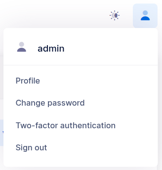
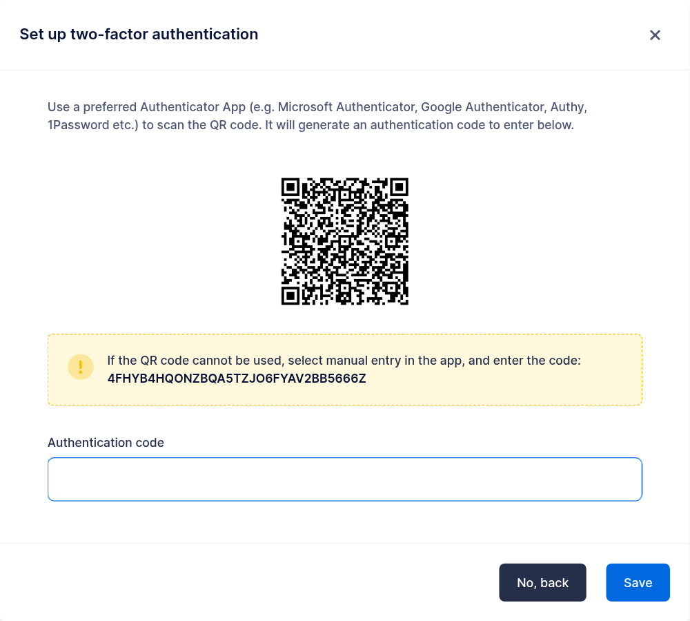
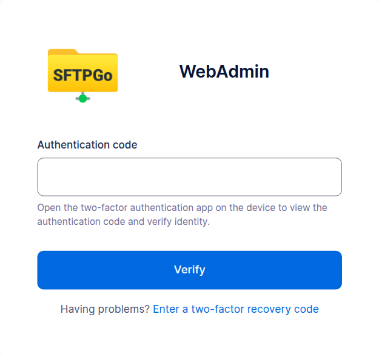
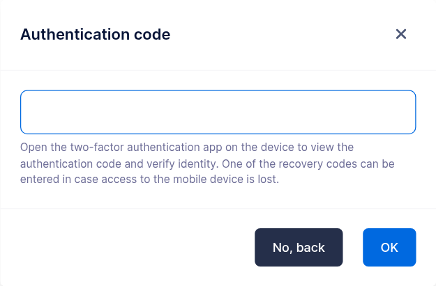

# Two-factor Authentication (2FA)

Two-factor authentication requires, in addition to the password, an authentication code generated by an app on a device the account owner holds: an attacker who obtains the password alone cannot log in.

SFTPGo supports authenticator apps that use TOTP (time-based one-time passwords, [RFC 6238](https://datatracker.ietf.org/doc/html/rfc6238){:target="_blank"}), such as Google Authenticator, Microsoft Authenticator, Authy, Aegis, FreeOTP, Bitwarden and 2FAS. The app shows a new code every 30 seconds, and each code is accepted only once.

## Where the authentication code is asked

For an admin account two-factor authentication covers the WebAdmin and the REST API. Users choose the protocols it covers: HTTP (WebClient and REST API), SSH and FTP. On the covered protocols the code is asked as follows.

| Access | Authentication code |
| ------ | ------------------- |
| WebAdmin, WebClient | On a dedicated page after the password. |
| WebAdmin, WebClient with [OpenID Connect](../oidc.md) | Not asked: the identity provider authenticates the account. |
| REST API token (`/api/v2/token`, `/api/v2/user/token`) | In the `X-SFTPGO-OTP` header of the token request. |
| REST API token obtained with an OpenID Connect token | Refused while two-factor authentication covers HTTP. |
| REST API with an [API key](../rest-api.md#api-key-authentication) | Not asked: an API key is a separate credential. |
| SSH, keyboard-interactive | After the password, in the same exchange. With a keyboard-interactive hook, see [SSH](#ssh). |
| SSH, public key followed by keyboard-interactive | After the key. |
| SSH, password method, public key, or their combinations | Not asked, see [SSH](#ssh). |
| FTP | Appended to the password, see [FTP](#ftp). |
| FTP with a TLS client certificate alone | Not asked, see [FTP](#ftp). |
| WebDAV | Not asked: WebDAV clients send the password with each request, and a code is accepted only once. |

Each new connection or token request needs a new code: a code accepted once is refused for the rest of its validity, also on other instances when the [data provider is shared](../config-file.md#data-provider) (`is_shared` set to `1`).

## Configure SFTPGo

Two-factor authentication is enabled by default with the following settings.

```json
  "mfa": {
    "totp": [
      {
        "name": "Default",
        "issuer": "SFTPGo",
        "algo": "sha1"
      }
    ],
    "disable_recovery_codes": false
  },
```

Alternatively (recommended), you can use environment variables by creating the file `/etc/sftpgo/env.d/mfa.env`. For example, to show your organization name in the authenticator apps and add a second configuration that uses `sha256`:

```shell
SFTPGO_MFA__TOTP__0__NAME="Default"
SFTPGO_MFA__TOTP__0__ISSUER="Example Corp"
SFTPGO_MFA__TOTP__0__ALGO="sha1"
SFTPGO_MFA__TOTP__1__NAME="SHA256"
SFTPGO_MFA__TOTP__1__ISSUER="Example Corp"
SFTPGO_MFA__TOTP__1__ALGO="sha256"
```

Restart SFTPGo to apply the changes.

- `name` identifies the configuration: users and admins see it when they set up 2FA, and their account stores it.
- `issuer` is the label the authenticator app shows next to the account, for example your organization name.
- `algo` is the hash algorithm: `sha1`, `sha256` or `sha512`.

`sha1` is the RFC 6238 default and works with every authenticator app. Google Authenticator (since 2023), Aegis, FreeOTP, Bitwarden, 2FAS and Ente Auth also honor `sha256` and `sha512`, while Microsoft Authenticator, Authy, Duo Mobile and 1Password generate `sha1` codes whatever the configured algorithm: SFTPGo detects this during setup and reports an error suggesting a compatible app or a configuration that uses `sha1`. App behavior changes with app releases, so check the apps your users have before choosing another algorithm.

You can define multiple configurations, for example one with `sha256` and one with `sha1`, and tell your users which one fits their app. Keep the `name` and the `algo` of a configuration unchanged while accounts use it: an account whose configuration name no longer exists cannot verify its authentication codes, and the app entries created with the previous algorithm generate codes that no longer match. To move accounts to another algorithm, add a new configuration and let them switch to it.

`disable_recovery_codes` (`SFTPGO_MFA__DISABLE_RECOVERY_CODES=true`) turns off the [recovery codes](#recovery-codes) for the whole server, see the [configuration file](../config-file.md#multi-factor-authentication).

## Set up 2FA

Admins open the setup page from the user menu at the top right of the WebAdmin, `Two-factor authentication`, available in the sessions opened with the password.

{data-gallery="admin-2fa"}

Users open it from the `2FA` entry of the WebClient left menu, and also select the protocols to protect.

Then:

1. select a configuration and click `Enable`;
2. scan the QR code with the authenticator app, or enter the displayed key manually in the app;
3. enter the authentication code the app shows and click `Save`.

{data-gallery="user-2fa-save"}

The configuration is saved once the code is verified, so a failed scan or an app that ignores the configured algorithm is reported here instead of at the next login. SFTPGo also generates the [recovery codes](#recovery-codes): view them in the `Recovery codes` section of the page, which asks for an authentication code first, and store them in a safe place, such as a password manager.

From the next login the authentication code is asked on the covered protocols, as described in [Using 2FA](#using-2fa).

{data-gallery="user-2fa-login"}

Admins can prevent a user, or the members of a group, from setting up 2FA by selecting `mfa-disabled` in the `Web client/REST API` restrictions.

{data-gallery="user-2fa-disabled"}

## Require 2FA

### Users

Select the protocols in the `Require 2FA for` field of the user restrictions, or of a group the user belongs to. Until the user configures 2FA for those protocols:

- the WebClient redirects to the two-factor authentication page, with the required protocols already selected; once the configuration is saved the user signs in again, this time with the authentication code;
- the REST API accepts the two-factor authentication calls only;
- SSH and FTP logins for a required protocol are refused.

The user cannot remove a required protocol from the configuration or disable 2FA.

:warning: Requiring 2FA for SSH makes the user configure it, and the code is asked by the SSH logins that use keyboard-interactive. To ask it at every SSH login, also restrict the login methods as described in [SSH](#ssh).

### Admins

Select `Two-factor authentication is required for this account` in the `2FA` field of the admin settings. The admin is redirected to the two-factor authentication page after a login with the password until 2FA is configured, then signs in again with the authentication code, and cannot disable it.

## Using 2FA

### WebAdmin and WebClient

The authentication code is asked on a dedicated page after the password. The `Enter a two-factor recovery code` link of that page accepts a [recovery code](#recovery-codes) instead.

{data-gallery="admin-2fa-login"}

### REST API

Send the authentication code in the `X-SFTPGO-OTP` header of the token request; the token is then used as usual. Every token request needs a new code, so for scripts and integrations use an [API key](../rest-api.md#api-key-authentication), which authenticates without a code. Managing two-factor authentication requires a token: API keys are refused for it.

```shell
curl -u nicola:password -H "X-SFTPGO-OTP: 123456" http://localhost:8080/api/v2/user/token
```

### SSH

With 2FA enabled for SSH, the code is asked by keyboard-interactive authentication:

- keyboard-interactive alone asks for the password and then for the authentication code;
- `publickey+keyboard-interactive` asks for the authentication code after the public key.

The SSH password method, the public key alone and their combinations (`publickey+password`, `password+publickey`) do not ask for the code. To ask it at every SSH login, deny them in the `Denied login methods` restrictions of the user or of a group: `password-over-SSH`, `publickey`, `publickey+password` and `password+publickey`. The SSH logins left are:

- keyboard-interactive: the password and the authentication code;
- `publickey+keyboard-interactive`: the public key and the authentication code;
- `keyboard-interactive+publickey`: the password, the authentication code and the public key.

`password-over-SSH` denies the password for SSH only: it keeps working for the other protocols. See [multi-step authentication](../ssh.md#multi-step-authentication) for how SFTPGo combines the methods.

A [keyboard-interactive hook](../keyboard-interactive.md) defines its own questions: the authentication code is asked when the hook sends a question with `check_password` set to `2`, otherwise the login completes without it.

Clients choose the method on their own: OpenSSH tries the public key first, then keyboard-interactive. To select keyboard-interactive explicitly:

```shell
$ sftp -o PreferredAuthentications=keyboard-interactive -P 2022 nicola@127.0.0.1
(nicola@127.0.0.1) Password:
(nicola@127.0.0.1) Authentication code:
Connected to 127.0.0.1.
sftp> quit
```

Each SSH connection needs a new code: clients that open further connections, for example for parallel or background transfers, ask for a code each time, or fail if they reuse the previous one. Limit them to one connection.

### FTP

FTP has no standard way to ask for a second factor: append the authentication code to the password. For example, with password `password` and code `123456`, use `password123456`.

Each FTP connection needs a new code, and clients store the password they were given: a client that opens further connections for transfers sends the same code again, and these connections are refused. Limit the client to one connection.

A login with a TLS client certificate alone does not ask for the code. To ask it at every FTP login of a user with a client certificate, deny the `TLSCertificate` login method: the certificate is then accepted together with the password and the appended code.

## Recovery codes

When two-factor authentication is enabled SFTPGo generates 12 recovery codes. Each code can be used once in place of an authentication code:

- to log in to the WebAdmin or the WebClient, from the `Enter a two-factor recovery code` link of the authentication code page;
- to confirm a change to the two-factor authentication settings.

SSH, FTP and the REST API token request accept authentication codes only.

The codes are listed in the `Recovery codes` section of the two-factor authentication page, where a new set can also be generated: generating new codes invalidates the previous ones. When fewer than 5 unused codes remain, the next save of the two-factor authentication configuration replaces them with a new set, so view the codes again after a save.

With the [`disable_recovery_codes`](../config-file.md#multi-factor-authentication) setting the recovery link and the recovery codes section are no longer shown; codes stored before are no longer accepted and are removed at the next save of the account.

## Change or disable 2FA

Once two-factor authentication is enabled, disabling it, generating a new secret with `Generate new secret key`, changing the protocols and viewing or regenerating the recovery codes require an authentication code from the app, or an unused recovery code. The page asks for it before applying the change.

{data-gallery="user-2fa-current-code"}

For a new secret the code is asked before the QR code is shown, while the app still holds only the current entry. In the web interface, selecting another configuration also generates a new secret, to scan again.

### REST API

The examples use the user endpoints; for an admin use `/api/v2/token` and the `/api/v2/admin/...` endpoints, without `protocols`.

Set up 2FA:

```shell
# generate a secret: the response contains the secret, the otpauth URL and the QR code
curl -X POST -H "Authorization: Bearer $TOKEN" -H "Content-Type: application/json" \
  -d '{"config_name": "Default"}' http://localhost:8080/api/v2/user/totp/generate
# save it with a code generated by the app for that secret
curl -X POST -H "Authorization: Bearer $TOKEN" -H "Content-Type: application/json" \
  -d '{"enabled": true, "config_name": "Default", "protocols": ["SSH", "HTTP"],
       "secret": {"status": "Plain", "payload": "<secret>"}, "passcode": "<code for the new secret>"}' \
  http://localhost:8080/api/v2/user/totp/save
```

With 2FA enabled, the generate request needs the current code in the `X-SFTPGO-OTP` header and returns a `verification_token`, valid for five minutes, only for the generated secret and from the same client address, like the access tokens. Send it in the `X-SFTPGO-TOTP-TOKEN` header of the save request, together with the `passcode` of the new secret; a failed attempt, for example a wrong code from the new app entry, can be repeated with the same token.

```shell
curl -X POST -H "Authorization: Bearer $TOKEN" -H "X-SFTPGO-OTP: <current code>" -H "Content-Type: application/json" \
  -d '{"config_name": "Default"}' http://localhost:8080/api/v2/user/totp/generate
curl -X POST -H "Authorization: Bearer $TOKEN" -H "X-SFTPGO-TOTP-TOKEN: <verification_token>" -H "Content-Type: application/json" \
  -d '{"enabled": true, "config_name": "Default", "protocols": ["SSH", "HTTP"],
       "secret": {"status": "Plain", "payload": "<new secret>"}, "passcode": "<code for the new secret>"}' \
  http://localhost:8080/api/v2/user/totp/save
```

The other changes send the current code in the `X-SFTPGO-OTP` header, for example to disable 2FA:

```shell
curl -X POST -H "Authorization: Bearer $TOKEN" -H "X-SFTPGO-OTP: <current code>" -H "Content-Type: application/json" \
  -d '{"enabled": false}' http://localhost:8080/api/v2/user/totp/save
```

The same header is required to view (`GET`) or regenerate (`POST`) the recovery codes at `/api/v2/user/2fa/recoverycodes`, and for an admin disabling their own 2FA with `/api/v2/admins/{username}/2fa/disable`.

To move the current secret to another configuration with the same algorithm, for example one with a different issuer, save `{"config_name": "<configuration>", "passcode": "<code>"}` with a code from the app: this code also proves the current second factor, so the `X-SFTPGO-OTP` header is not needed. A configuration with another algorithm requires a new secret, because the app entry keeps generating codes with the algorithm it was created with.

## Lost second factor

A user or admin who lost access to the authenticator app can log in to the web interface with a [recovery code](#recovery-codes) and set up a new secret.

Without recovery codes, an administrator can disable two-factor authentication for the account:

- for a user, from the `Disable 2FA` action of the users list in the WebAdmin, or with the `/api/v2/users/{username}/2fa/disable` REST endpoint. This requires the `disable_mfa` [permission](../admin-permissions.md);
- for another admin, from the `Disable 2FA` action of the admins list, or with the `/api/v2/admins/{username}/2fa/disable` REST endpoint. This requires the `*` permission.

An administrator with access to the system where SFTPGo is installed can also disable two-factor authentication for an admin account from the command line, with [`sftpgo resetadmin --admin <username> --reset-two-factor`](../cli.md).

When an administrator disables two-factor authentication for an account, the password alone logs in to that account until its owner configures a new second factor. If the password may be known to someone else, change it before disabling two-factor authentication and give the new one to the owner through a separate channel.

## Troubleshooting

- **Every code is refused.** TOTP codes depend on the time: the clocks of the server and of the device must agree within about 30 seconds. Synchronize both, for example with NTP on the server and automatic time on the device.
- **A code is refused right after a successful login.** Each code is accepted once: wait for the next one. Clients that open several connections need a new code for each, see [SSH](#ssh) and [FTP](#ftp).
- **SSH logs in without asking for the code.** The client used a login method without keyboard-interactive, such as the password method or a public key, or a keyboard-interactive hook does not ask for the code, see [SSH](#ssh).
- **FTP logs in without asking for the code.** The client authenticated with a TLS certificate alone, see [FTP](#ftp).
- **The setup reports that the app generates SHA-1 codes.** The app ignores the algorithm of the configuration: use an app that honors it, or a configuration with `sha1`.
- **The setup has expired.** More than five minutes passed since the secret was generated: generate a new one and scan it again.
- **Codes stopped working for every account of a configuration.** The configuration was renamed or removed, or its algorithm changed: restore it. Users can also log in to the web interface with a recovery code and set up a new secret.
